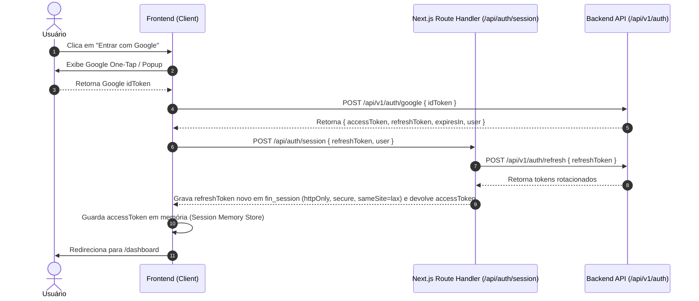

# Arquitetura de Software do Frontend

Este documento descreve a arquitetura do frontend do **FIN**, detalhando a estratégia do Next.js App Router, o fluxo de autenticação e tokens, o cliente HTTP desacoplado, o tratamento de erros estruturados e o middleware de proteção.

---

## 1. Estrutura de Diretórios da Aplicação

A aplicação adota uma organização modular baseada no Next.js App Router:

```
src/ ou raiz:
├── app/
│   ├── (public)/                 # Grupo de rotas públicas
│   │   ├── layout.tsx            # Layout sem sidebar (centralizado)
│   │   └── login/page.tsx        # Tela de login com Google
│   ├── (app)/                    # Grupo de rotas autenticadas (protegidas por middleware)
│   │   ├── layout.tsx            # Shell responsivo (Sidebar desktop + Topbar + BottomNav mobile)
│   │   ├── dashboard/page.tsx    # "Início"
│   │   ├── transactions/page.tsx # "Transações"
│   │   ├── accounts/page.tsx     # "Contas"
│   │   ├── cards/page.tsx        # "Cartões de Crédito"
│   │   │   └── [id]/invoices/[ym]/page.tsx # Fatura detalhada
│   │   ├── goals/page.tsx        # "Metas"
│   │   ├── reports/page.tsx      # "Relatórios"
│   │   ├── categories/page.tsx   # "Categorias"
│   │   ├── simulations/          # "Simulações"
│   │   │   ├── investment/page.tsx
│   │   │   └── debt/page.tsx
│   │   └── settings/page.tsx     # "Configurações"
│   ├── api/                      # Route Handlers internos do Next.js (BFF para cookies de sessão)
│   │   └── auth/
│   │       ├── session/route.ts  # Grava/lê cookie seguro
│   │       └── logout/route.ts   # Remove cookie e invalida sessão
│   ├── globals.css               # Variáveis CSS e tema Tailwind v4
│   ├── layout.tsx                # Root layout com Font Inter e Providers globais
│   ├── not-found.tsx             # 404 customizado
│   └── error.tsx                 # Error boundary global
├── components/
│   ├── ui/                       # Primitivos shadcn/ui (Button, Card, Input, Dialog, etc.)
│   ├── layout/                   # Sidebar, Topbar, BottomNav, MobileSheet, FabAction
│   ├── dashboard/                # Componentes exclusivos do Início
│   ├── transactions/             # Componentes de transações e filtros
│   ├── cards/                    # Componentes de cartões e faturas
│   ├── goals/                    # Componentes de metas e progresso
│   ├── charts/                   # Wrappers do Recharts com estilização padronizada
│   └── icons/                    # CategoryIcon e ícones mapeados
├── hooks/                        # Custom hooks do React Query e utilitários de UI
├── lib/
│   ├── api/                      # Cliente HTTP, endpoints e mapeamento de erros
│   │   ├── client.ts             # Função genérica apiFetch com interceptors
│   │   ├── errors.ts             # Classe ApiError e parser de ProblemDetail
│   │   └── endpoints/            # Serviços tipados por recurso
│   ├── query/                    # QueryKeys e QueryProvider
│   ├── format/                   # Formatadores BRL e datas
│   ├── mock-data.ts              # Base determinística para testes e desenvolvimento offline
│   ├── config.ts                 # Constantes de configuração (USE_MOCK, API_BASE_URL)
│   └── utils.ts                  # Utilitários (cn helper)
└── types/                        # Tipagens TypeScript globais do domínio
```

---

## 2. Server Components vs. Client Components

Para manter excelente performance e SEO:

- **Server Components (Padrão):**
  - Layouts estáticos (`layout.tsx`), wrappers estruturais e cascas de páginas.
  - Não utilizam hooks (`useState`, `useEffect`, `useQuery`).
- **Client Components (`'use client'`):**
  - Todas as páginas ou componentes que realizam data fetching reativo via TanStack Query.
  - Componentes com interatividade de usuário (formulários, modais, dropdowns, abas, filtros).
  - Componentes que renderizam gráficos interativos do Recharts.

---

## 3. Fluxo de Autenticação e Sessão

A autenticação é baseada em OAuth 2.0 com Google Identity Services integrado à API REST do FIN:



### Detalhes de Segurança dos Tokens:
1. **Access Token:** Mantido estritamente em memória do navegador (Zustand ou variável de módulo). Tem validade curta (15 minutos).
2. **Refresh Token:** Armazenado isoladamente em cookie `httpOnly`, `secure` em produção e `sameSite=lax`. O navegador não lê o token.
3. **Renovação Automática (Rotação de Tokens):** Quando falta o access token em memória ou uma requisição à API retorna `401 Unauthorized`, o cliente chama `POST /api/auth/refresh`. O Route Handler lê o cookie, chama `POST /api/v1/auth/refresh`, grava o refresh token rotacionado e devolve apenas o novo access token. O cliente repete a requisição original uma única vez.

---

## 4. Cliente HTTP Centralizado (`apiFetch`)

Toda comunicação com o backend passa pela função utilitária `apiFetch<T>` em `lib/api/client.ts`:

```typescript
export interface RequestOptions extends RequestInit {
  params?: Record<string, string | number | boolean | undefined | null>;
}

export async function apiFetch<T>(endpoint: string, options: RequestOptions = {}): Promise<T> {
  const baseUrl = process.env.NEXT_PUBLIC_API_URL || 'http://localhost:8080/api/v1';
  
  // 1. Constrói a URL com Query Parameters limpos (remove nulos e indefinidos)
  const url = buildUrl(baseUrl, endpoint, options.params);

  // 2. Injeta cabeçalhos padrão (Content-Type e Authorization Bearer)
  const headers = new Headers(options.headers);
  headers.set('Content-Type', 'application/json');
  
  const token = getAccessTokenFromMemory();
  if (token) {
    headers.set('Authorization', `Bearer ${token}`);
  }

  // 3. Executa a requisição
  const response = await fetch(url.toString(), { credentials: 'include', ...options, headers });

  // 4. Intercepta 401 para tentar refresh token
  if (response.status === 401) {
    const refreshed = await attemptTokenRefresh();
    if (refreshed) {
      // Re-executa com o novo token
      headers.set('Authorization', `Bearer ${getAccessTokenFromMemory()}`);
      const retryResponse = await fetch(url.toString(), { credentials: 'include', ...options, headers });
      return handleResponse<T>(retryResponse);
    }
    // Falha de renovação: redireciona para login
    handleLogout();
  }

  return handleResponse<T>(response);
}
```

---

## 5. Tratamento Estruturado de Erros (`ProblemDetail` -> `ApiError`)

O backend responde erros no padrão RFC 7807. O frontend mapeia essa estrutura para a classe de erro customizada `ApiError` em `lib/api/errors.ts`:

```typescript
export interface ValidationError {
  field: string;
  message: string;
}

export interface ProblemDetail {
  type: string;
  title: string;
  status: number;
  detail: string;
  instance?: string;
  errors?: ValidationError[];
}

export class ApiError extends Error {
  public readonly status: number;
  public readonly title: string;
  public readonly detail: string;
  public readonly errors: ValidationError[];

  constructor(problem: ProblemDetail) {
    super(problem.detail || problem.title);
    this.name = 'ApiError';
    this.status = problem.status;
    this.title = problem.title;
    this.detail = problem.detail;
    this.errors = problem.errors || [];
  }

  /**
   * Retorna a mensagem de erro vinculada a um campo específico de formulário
   */
  getFieldError(fieldName: string): string | undefined {
    return this.errors.find((err) => err.field === fieldName)?.message;
  }
}
```

---

## 6. Middleware de Proteção de Rotas (`middleware.ts`)

O arquivo `middleware.ts` na raiz do projeto protege o grupo de rotas autenticadas:

```typescript
import { NextResponse } from 'next/server';
import type { NextRequest } from 'next/server';

const PUBLIC_ROUTES = ['/login'];

export function middleware(request: NextRequest) {
  const { pathname } = request.nextUrl;
  const sessionCookie = request.cookies.get('fin_session');
  const isAuthenticated = Boolean(sessionCookie?.value);

  // 1. Usuário não autenticado tentando acessar rota privada
  if (!isAuthenticated && !PUBLIC_ROUTES.includes(pathname)) {
    const loginUrl = new URL('/login', request.url);
    loginUrl.searchParams.set('from', pathname);
    return NextResponse.redirect(loginUrl);
  }

  // 2. Usuário autenticado tentando acessar a tela de login
  if (isAuthenticated && PUBLIC_ROUTES.includes(pathname)) {
    return NextResponse.redirect(new URL('/dashboard', request.url));
  }

  return NextResponse.next();
}

export const config = {
  matcher: ['/((?!_next/static|_next/image|favicon.ico|api/auth).*)'],
};
```

---

## 7. Flag `USE_MOCK` e Camada de Serviços Desacoplada

Para permitir o desenvolvimento frontend ágil mesmo sem o backend rodando:

```typescript
// lib/config.ts
export const USE_MOCK = process.env.NEXT_PUBLIC_USE_MOCK === 'true' || true;
```

Todos os serviços em `lib/api/endpoints/*.ts` implementam o desvio transparente:

```typescript
// Exemplo: lib/api/endpoints/accounts.ts
import { USE_MOCK } from '@/lib/config';
import { apiFetch } from '@/lib/api/client';
import { mockAccountsResponse } from '@/lib/mock-data';
import type { AccountsResponse, AccountRequest, Account } from '@/types';

export async function getAccounts(): Promise<AccountsResponse> {
  if (USE_MOCK) {
    await simulateNetworkDelay(300);
    return mockAccountsResponse;
  }
  return apiFetch<AccountsResponse>('/accounts');
}
```
Isso garante que as telas e hooks nunca saibam se os dados são reais ou mockados.

